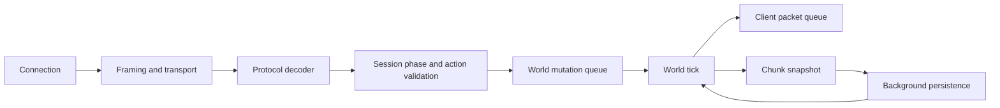

# Architecture and lifecycle

[Русский](../rus/architecture.md) · [Documentation](README.md)

Vitis is organized into Go packages. The entrypoint creates the server systems and connects their handlers.

## Responsibilities

| Subsystem | Responsible for | Interaction |
| --- | --- | --- |
| [Server startup](../../cmd/vitis/main.go) | Configuration, access lists, resources, session callbacks and shutdown | Creates and connects the systems |
| [Network](../../internal/network/) | Connections, framing, timeouts, queues, encryption and compression | Delivers data in connection order |
| [Protocol](../../internal/protocol/) | Packet types, bounded reads, NBT encoding and codec registration | Converts network data into typed packets |
| [Session](../../internal/session/) | Protocol states, authentication, player admission and actions | Validates client actions and passes them to game systems |
| [World](../../internal/world/) | Ticks, dimensions, chunks, simulation and saving | Applies world changes and background results |
| [Entity](../../internal/entity/) and mechanics | Entity state, combat, inventory, crafting and loot | Applies game rules |
| [Datapack](../../internal/datapack/) and [registry](../../internal/registry/) | Resources, IDs, tags and client configuration data | Loads game resources and separately synchronizes protocol registries |

## Main data flow

Status, login and configuration are handled within the session before a player joins the world. Their responses are sent directly without using the world queue.

## Concurrency and ownership

Incoming packets on one connection are processed in order, including state changes and enabling encryption or compression. A bounded shared worker pool handles connections in parallel.

`World.Submit(func()) bool` queues a world task. It returns `false` when the queue is full; callers must handle rejection. Keep tasks short. Disk IO, authentication and resource compilation run outside the tick.

Background workers load and generate chunks; the world applies completed results during ticks. Streaming reads ready chunks. Saving uses data snapshots; resource reload publishes an immutable compiled snapshot.

Some state uses locks and atomics; player lifecycle operations are coordinated separately. Before calling a method from another goroutine, inspect its synchronization, callers and tests.

## Startup and shutdown

Startup creates missing configuration and access files, validates YAML and configures logging. It then validates the existing world and makes a backup if needed, prepares vanilla resources without Java and loads datapacks. After creating dimensions and starting ticks, it connects registries, sessions and game handlers, then starts network services and background tasks.

SIGINT, SIGTERM or `stop` starts shutdown. The server cancels background tasks, stops network services, closes connections, waits for player lifecycle work, stops ticks and finishes saving worlds. All stages share a deadline. See [operations](operations.md) and [storage](storage.md).

## Working on a subsystem

See [protocol](protocol.md) for network changes, [world](world.md) for chunks and simulation, and [gameplay](gameplay.md) for game handlers. Feature additions are covered in [extension guides](extending.md), data preparation in [generators](generators/README.md), and limitations in [project status](status.md).
