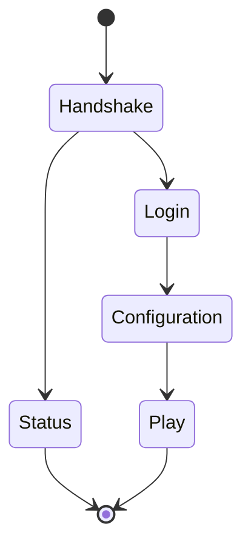

# Network transport and protocol flows

[Русский](../rus/protocol.md) · [Documentation](README.md)

## Transport

[Conn](../../internal/network/conn.go) handles the socket, timeouts and outbound queue. The [pipeline](../../internal/network/pipeline.go) handles framing, compression and session dispatch. [Decompression](../../internal/network/compression.go) checks compressed-data limits.

Uncompressed frames contain `VarInt(frame length) + VarInt(packet ID) + payload`. After compression negotiation, contents begin with `VarInt(uncompressed length)`: zero means the remainder is uncompressed; otherwise it contains zlib data. Online authentication enables encryption of the byte stream. Sizes are checked before allocation and decompression.

A codec is registered for a version, state, direction and ID. `AnyVersion` is a fallback for codec lookup; the handshake checks the supported Minecraft version.

## Session states

| State | Server actions |
| --- | --- |
| Handshake | Check protocol version and select status or login |
| Status | Server-list response and ping; player count comes from admitted Play sessions |
| Login | Check name, IP and access, authenticate or derive an offline UUID, negotiate compression and send success |
| Configuration | Exchange known-pack information, registries and tags; wait for completion acknowledgement |
| Play | Prepare player state, validate actions, check connection health, handle gameplay and chunk feedback |

Login and configuration have internal stages. The session checks packet and acknowledgement order. Reconfiguration after entering Play is not currently initiated, although the state machine allows Play → Configuration.

## Online and offline login

With `online_mode: true`, the server generates RSA keys, verifies the encryption token, enables AES/CFB8 and checks Mojang's session service. With `false`, it derives a UUID from the name without authenticating the account. See [operations](operations.md) for access-list behavior.

Compression and encryption changes must stay ordered with negotiation packets. Do not move stage handling into unordered background jobs or change connection flags before sending the corresponding frame.

## Validation and handlers

Packets implement [Packet](../../internal/protocol/packet.go): `ID()`, `Decode(*Buffer) error`, `Encode(*Buffer) error`. Bound strings, collections, components and NBT. Reject malformed VarInts, invalid lengths, prohibited trailing bytes, and NaN or infinite movement values.

After decoding, game handlers check the player, reach, game mode, inventory state and whether the action is allowed. These checks run on the server.

[play_policy.go](../../internal/session/play_policy.go) lists packets accepted without performing actions, including vehicle control, signed chat, trading and several special interfaces. Add a handler for a new packet or explicitly state why it is accepted without an action.

## Sources and tests

[Session processing](../../internal/session/session.go), [protocol stages](../../internal/session/protocol_flow.go), [login](../../internal/session/login_handler.go), [configuration](../../internal/session/configuration_handler.go), [codec registration](../../internal/protocol/states/).

Run `go test ./internal/protocol/... ./internal/network/... ./internal/session -count=1`. Check encoding and decoding, malformed input and transition order. See [packet IDs](packets/packet-ids.md) and [version upgrades](generators/version-upgrade.md) for ID changes.
