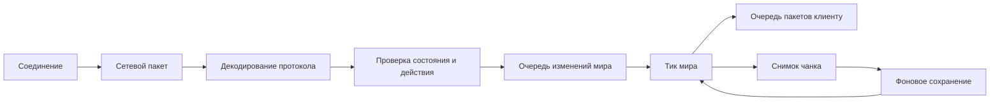

# Архитектура и жизненный цикл

[English](../eng/architecture.md) · [Документация](README.md)

Vitis разделён на Go-пакеты. Точка входа собирает подсистемы сервера и связывает их обработчики.

## Ответственность подсистем

| Подсистема | Отвечает за | Взаимодействие |
| --- | --- | --- |
| [Запуск сервера](../../cmd/vitis/main.go) | Настройки, списки доступа, загрузку ресурсов, обработчики сессий и остановку | Создаёт и связывает подсистемы |
| [Сеть](../../internal/network/) | Соединения, границы пакетов, таймауты, очереди, шифрование и сжатие | Передаёт данные в порядке соединения |
| [Протокол](../../internal/protocol/) | Типы пакетов, чтение с проверкой границ, кодирование NBT и регистрацию кодеков | Преобразует сетевые данные в типизированные пакеты |
| [Сессии](../../internal/session/) | Состояния протокола, авторизацию, допуск игроков и обработку действий | Проверяет действия клиента и передаёт их игровым подсистемам |
| [Мир](../../internal/world/) | Тики, измерения, чанки, симуляцию и сохранение | Выполняет изменения мира и применяет результаты фоновых задач |
| [Сущности](../../internal/entity/) и игровые механики | Состояние сущностей, бой, инвентарь, крафт и добычу | Обрабатывают игровые правила |
| [Датапаки](../../internal/datapack/) и [реестры](../../internal/registry/) | Ресурсы, идентификаторы, теги и данные для настройки клиента | Загружают игровые ресурсы и отдельно синхронизируют реестры протокола |

## Основной поток данных

Запрос статуса, вход и настройка клиента обрабатываются в сессии до появления игрока в мире. Их ответы отправляются напрямую, без очереди мира.

## Конкурентность и владение состоянием

Входящие пакеты одного соединения обрабатываются последовательно, включая смену состояний, включение шифрования и сжатия. Общий пул обработчиков ограничивает параллелизм между соединениями.

`World.Submit(func()) bool` ставит задачу в очередь мира. При переполнении возвращается `false`; вызывающий код должен обработать отказ. Задачи должны быть короткими. Дисковые операции, авторизация и компиляция ресурсов выполняются вне тика.

Фоновые обработчики загружают и генерируют чанки, а мир применяет готовые результаты во время тика. Отправка клиенту читает готовые чанки. Сохранение использует снимки данных; перезагрузка ресурсов публикует неизменяемый набор скомпилированных ресурсов.

Часть состояния защищена блокировками и атомарными операциями; жизненный цикл игрока координируется отдельно. Перед вызовом метода из другой горутины проверьте его синхронизацию, вызывающий код и тесты.

## Запуск и остановка

При запуске сервер создаёт отсутствующие настройки и списки доступа, проверяет YAML и настраивает логирование. Затем проверяет существующий мир и при необходимости делает резервную копию, подготавливает ресурсы Minecraft без Java и загружает датапаки. После создания измерений и запуска тиков связывает реестры, сессии и игровые обработчики, запускает сетевые службы и фоновые задачи.

SIGINT, SIGTERM или команда `stop` запускают остановку. Сервер отменяет фоновые задачи, останавливает сетевые службы, закрывает соединения, дожидается обработки выхода игроков, останавливает тики и завершает сохранение миров. Все этапы используют общий таймаут. Подробности — в [эксплуатации](operations.md) и [хранении](storage.md).

## Работа с подсистемами

Сетевые изменения описаны в [протоколе](protocol.md), чанки и симуляция — в [устройстве мира](world.md), игровые обработчики — в [карте подсистем](gameplay.md). Добавление функциональности разобрано в [практических руководствах](extending.md). Подготовка данных — в [генераторах](generators/README.md), ограничения — в [статусе проекта](status.md).
