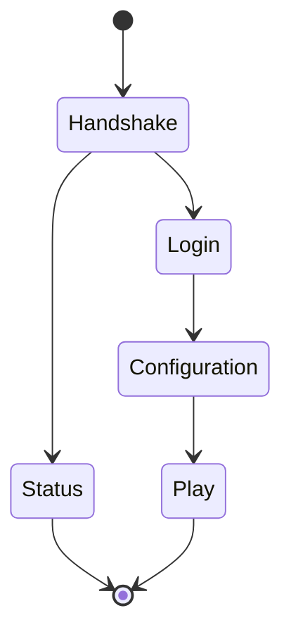

# Сеть и состояния протокола

[English](../eng/protocol.md) · [Документация](README.md)

## Передача данных

[Conn](../../internal/network/conn.go) отвечает за сокет, таймауты и очередь исходящих пакетов. [Pipeline](../../internal/network/pipeline.go) выделяет сетевые пакеты, обрабатывает сжатие и передаёт данные сессии. [Распаковка](../../internal/network/compression.go) проверяет лимиты сжатых данных.

Без сжатия пакет содержит `VarInt(frame length) + VarInt(packet ID) + payload`. После согласования сжатия содержимое начинается с `VarInt(uncompressed length)`: ноль означает несжатый остаток, иначе далее идут данные zlib. После авторизации включается шифрование потока байтов. Размеры проверяются до выделения памяти и распаковки данных клиента.

Кодек регистрируется для версии, состояния, направления и ID. `AnyVersion` служит запасным вариантом поиска кодека; при подключении сервер проверяет поддерживаемую версию Minecraft.

## Состояния сессии

| Состояние | Действия сервера |
| --- | --- |
| Handshake | Проверка версии протокола и выбор запроса статуса или входа |
| Status | Ответ для списка серверов и проверка задержки; число игроков берётся из допущенных игровых сессий |
| Login | Проверка имени, IP и доступа, авторизация либо UUID по имени, согласование сжатия и ответ об успешном входе |
| Configuration | Обмен сведениями об известных пакетах ресурсов, реестрами и тегами; ожидание подтверждения настройки |
| Play | Подготовка игрока, проверка действий, контроль соединения, игровые обработчики и подтверждения чанков |

Вход и настройка клиента разделены на внутренние этапы. Сессия проверяет порядок пакетов и подтверждений. Повторная настройка клиента после перехода в Play сейчас не запускается, хотя переход Play → Configuration предусмотрен в машине состояний.

## Вход с проверкой аккаунта и без неё

При `online_mode: true` сервер генерирует ключи RSA, проверяет токен шифрования, включает AES/CFB8 и обращается к службе сессий Mojang. При `false` UUID вычисляется по имени без проверки аккаунта. Особенности списков доступа описаны в [эксплуатации](operations.md).

Включение сжатия и шифрования должно сохранять порядок относительно пакетов согласования. Обработку этапов нельзя переносить в неупорядоченные фоновые задачи или менять параметры соединения до отправки соответствующего пакета.

## Проверки и обработчики

Пакеты реализуют интерфейс [Packet](../../internal/protocol/packet.go): `ID()`, `Decode(*Buffer) error`, `Encode(*Buffer) error`. Ограничивайте строки, коллекции, компоненты и NBT; отклоняйте некорректные VarInt, длины, лишние байты и нечисловые или бесконечные координаты.

После декодирования игровые обработчики проверяют игрока, дальность взаимодействия, режим игры, состояние инвентаря и допустимость действия. Эти проверки выполняются на сервере.

[play_policy.go](../../internal/session/play_policy.go) перечисляет пакеты, принимаемые без выполнения действий: управление транспортом, подписанный чат, торговлю и ряд специальных интерфейсов. Для нового пакета добавьте обработчик либо явно укажите причину такого приёма.

## Исходники и тесты

[Обработка сессии](../../internal/session/session.go), [этапы протокола](../../internal/session/protocol_flow.go), [вход](../../internal/session/login_handler.go), [настройка клиента](../../internal/session/configuration_handler.go), [регистрация кодеков](../../internal/protocol/states/).

Запускайте `go test ./internal/protocol/... ./internal/network/... ./internal/session -count=1`. Проверяйте кодирование и декодирование, некорректные входные данные и порядок переходов. Изменение ID описано в [идентификаторах пакетов](packets/packet-ids.md) и [обновлении версии](generators/version-upgrade.md).
